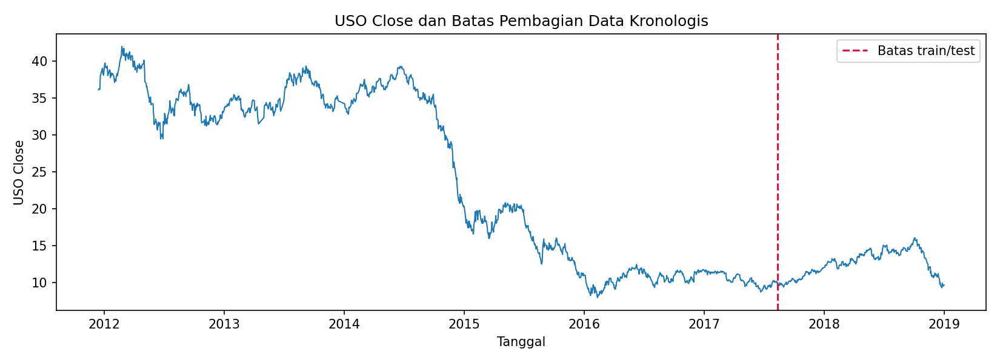
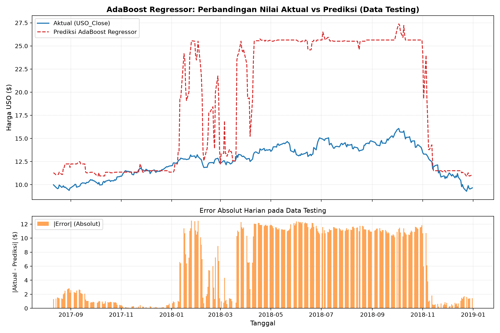
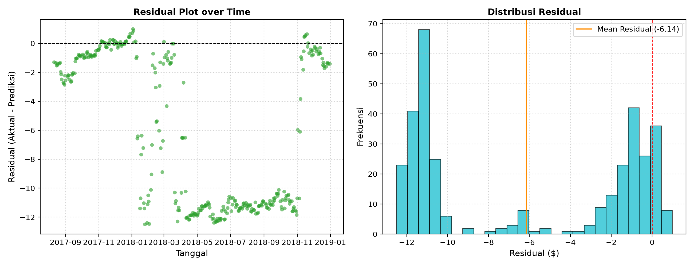
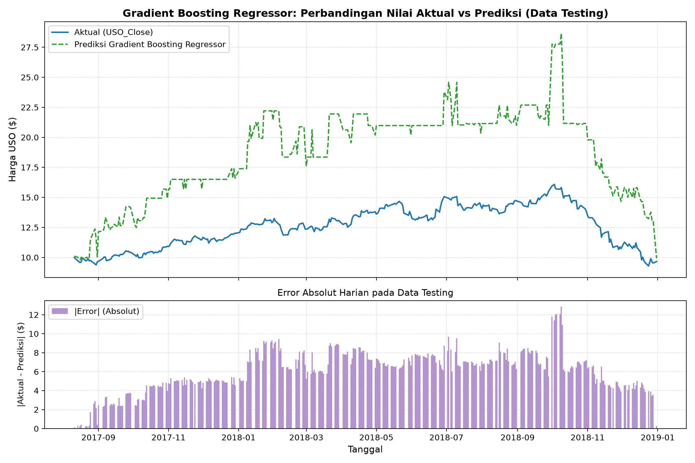
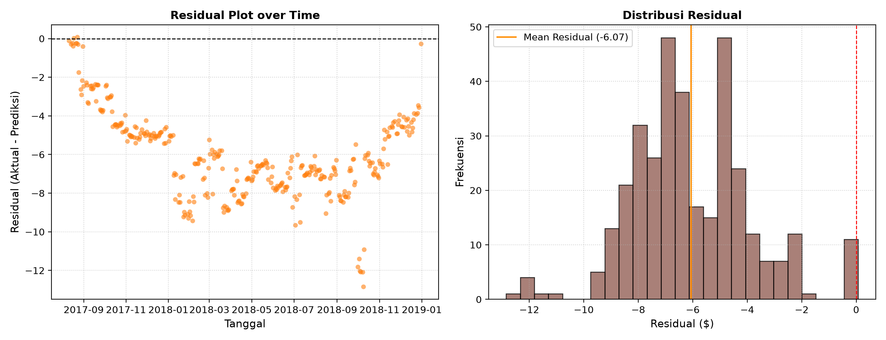
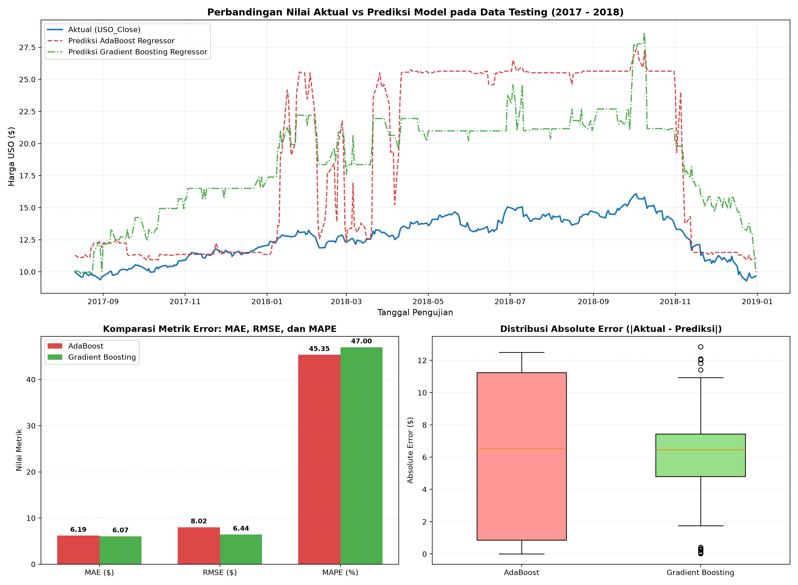

# LAPORAN PRAKTIKUM PEMBELAJARAN MESIN
## TUGAS PERTEMUAN 11 — REGRESI

**Prediksi Harga Penutupan ETF USO Menggunakan AdaBoost Regressor dan Gradient Boosting Regressor**

Dosen Pengampu: Purbandini, S.Si., M.Kom.

Kelas TI-C8 — Kelompok 6

**Anggota Kelompok:**
1. I GEDE ARYA SAPUTRA — 434241127 (Person 1)
2. RYAN ERMAULID APRIANSYAH — 434241129 (Person 2)
3. ROISATUL UMMAH — 434241130 (Person 3)

FAKULTAS VOKASI  
UNIVERSITAS AIRLANGGA  
TAHUN AJARAN 2026/2027

---

# KATA PENGANTAR

Puji syukur penulis panjatkan kepada Tuhan Yang Maha Esa atas terselesaikannya laporan Praktikum Machine Learning Pertemuan 11 tentang regresi. Laporan ini membahas penerapan algoritma AdaBoost Regressor dan Gradient Boosting Regressor untuk memprediksi harga penutupan ETF USO.

Pembahasan meliputi pengolahan dataset, implementasi model, evaluasi menggunakan lima metrik regresi, perbandingan performa, serta pembuatan aplikasi prediksi berbasis Streamlit.

Penulis menyadari bahwa laporan ini masih memiliki kekurangan. Oleh karena itu, kritik dan saran yang membangun diharapkan dapat menjadi bahan perbaikan. Semoga laporan ini bermanfaat bagi pembaca.

Surabaya, November 2026

Penulis

---

# BAB I — PENDAHULUAN

## 1.1 Latar Belakang dan Tujuan

Harga aset keuangan dipengaruhi oleh berbagai faktor pasar, seperti harga komoditas, indeks saham, dan nilai tukar. Hubungan antarvariabel tersebut dapat membentuk pola yang kompleks sehingga diperlukan metode regresi untuk mempelajari hubungan antara variabel prediktor dan nilai yang ingin diperkirakan.

Pada praktikum ini, Kelompok 6 menggunakan dataset FINAL_USO untuk memprediksi harga penutupan ETF United States Oil Fund (USO). Dua algoritma yang diterapkan adalah AdaBoost Regressor dan Gradient Boosting Regressor.

Tujuan pengerjaan ini adalah:
1. Melakukan preprocessing dataset agar siap digunakan dalam pemodelan.
2. Mengimplementasikan AdaBoost Regressor dan Gradient Boosting Regressor.
3. Mengevaluasi kedua model menggunakan MAE, MAPE, MSE, RMSE, dan R².
4. Membandingkan performa model dan menentukan model terbaik.
5. Mengembangkan antarmuka prediksi menggunakan Streamlit.

## 1.2 Pembagian Tugas

Pembagian tugas anggota kelompok adalah sebagai berikut:

| Person | Tanggung Jawab | Output |
|---|---|---|
| Person 1 — I Gede Arya Saputra | Dataset, preprocessing, penanganan leakage, pembagian data kronologis 80:20, dan integrasi pipeline | `output/person1/`, `code/01_preprocessing.py` |
| Person 2 — Ryan Ermaulid Apriansyah | Implementasi AdaBoost Regressor, eksperimen hyperparameter, dan evaluasi 5 metrik regresi | `output/person2/`, `code/02_adaboost_person2.py` |
| Person 3 — Roisatul Ummah | Implementasi Gradient Boosting Regressor, tuning loss absolute error, dan evaluasi 5 metrik regresi | `output/person3/`, `code/03_gradient_boosting_person3.py` |
| Seluruh anggota | Validasi silang, perbandingan model, pengembangan UI/UX Streamlit Pink Aesthetic, dan penyusunan laporan | `output/model_comparison/`, `app.py`, Laporan Final |

---

# BAB II — LANDASAN TEORI

## 2.1 Regresi dan Metrik Evaluasi

Regresi merupakan metode supervised learning yang digunakan untuk memprediksi nilai numerik berdasarkan hubungan antara fitur (X) dan target (y). Dalam praktikum ini, regresi digunakan untuk memperkirakan harga penutupan ETF USO.

Evaluasi model dilakukan dengan membandingkan nilai aktual ($y_i$) dan nilai prediksi ($\hat{y}_i$) menggunakan lima metrik berikut:

1. **Mean Absolute Error (MAE)**: mengukur rata-rata selisih absolut antara nilai aktual dan prediksi. Nilai lebih kecil menunjukkan kesalahan yang lebih rendah.
   $$\text{MAE} = \frac{1}{n} \sum_{i=1}^n |y_i - \hat{y}_i|$$
2. **Mean Absolute Percentage Error (MAPE)**: mengukur rata-rata persentase kesalahan prediksi terhadap nilai aktual.
   $$\text{MAPE} = \frac{100\%}{n} \sum_{i=1}^n \left| \frac{y_i - \hat{y}_i}{y_i} \right|$$
3. **Mean Squared Error (MSE)**: menghitung rata-rata kuadrat kesalahan sehingga memberikan penalti lebih besar pada kesalahan yang tinggi.
   $$\text{MSE} = \frac{1}{n} \sum_{i=1}^n (y_i - \hat{y}_i)^2$$
4. **Root Mean Squared Error (RMSE)**: merupakan akar dari MSE dan memiliki satuan yang sama dengan target.
   $$\text{RMSE} = \sqrt{\text{MSE}}$$
5. **R² Score**: mengukur kemampuan model dalam menjelaskan variasi target. Nilai yang lebih tinggi menunjukkan hasil relatif lebih baik. Nilai negatif menunjukkan model lebih buruk dibandingkan baseline prediksi rata-rata target pada data pengujian.
   $$R^2 = 1 - \frac{\sum_{i=1}^n (y_i - \hat{y}_i)^2}{\sum_{i=1}^n (y_i - \bar{y})^2}$$

## 2.2 Algoritma AdaBoost Regressor

AdaBoost Regressor merupakan algoritma ensemble boosting yang menggabungkan beberapa weak learner secara bertahap. Model memberikan perhatian lebih besar terhadap sampel yang memiliki kesalahan prediksi tinggi pada proses pembelajaran berikutnya.

Pada praktikum ini, AdaBoost menggunakan Decision Tree Regressor sebagai base estimator untuk membentuk model prediksi harga USO.

## 2.3 Algoritma Gradient Boosting Regressor

Gradient Boosting Regressor merupakan algoritma ensemble yang membangun model secara bertahap. Setiap model berikutnya berusaha memperbaiki kesalahan atau residual dari model sebelumnya melalui pendekatan optimasi fungsi loss (seperti Least Absolute Deviation / L1 Loss).

Algoritma ini digunakan untuk mempelajari pola hubungan antara indikator pasar dan harga penutupan ETF USO secara adaptif dan tangguh terhadap pencilan (*outliers*).

## 2.4 UI/UX Model Machine Learning

UI/UX merupakan bagian antarmuka yang memungkinkan pengguna berinteraksi dengan model secara intuitif. Dalam praktikum ini, antarmuka dikembangkan menggunakan Streamlit dengan tema visual modern (*Pink Aesthetic*) agar pengguna dapat melihat metrik, grafik interaktif, mengunggah data CSV, menjalankan prediksi, dan mengunduh hasilnya.

---

# BAB III — METODOLOGI

## 3.1 Dataset dan Preprocessing

Dataset yang digunakan adalah `FINAL_USO.csv`, yaitu data sekunder yang diperoleh dari sumber online melalui Kaggle. Dataset memiliki 1.718 baris dan 81 kolom, dengan rentang tanggal 15 Desember 2011 sampai 31 Desember 2018.

Sumber dataset:  
https://www.kaggle.com/datasets/suryanachoudhary/gold-price-prediction

Target yang digunakan adalah `USO_Close`, sedangkan fitur prediktor terdiri atas 74 kolom numerik yang dipilih dari indikator pasar selain kolom tanggal dan kolom berawalan `USO_`.

Kolom `USO_*` selain target dikeluarkan dari fitur untuk menghindari kebocoran informasi (*data leakage*).

Tahapan preprocessing meliputi:
1. Pemeriksaan struktur dan tipe data.
2. Pemeriksaan missing value dan duplikasi.
3. Pengurutan data berdasarkan tanggal secara kronologis.
4. Pemilihan fitur (74 prediktor) dan target (`USO_Close`).
5. Imputasi median yang dihitung dari data training.
6. Pembagian data secara kronologis dengan rasio 80:20 (tanpa pengacakan).

Hasil pembagian data:

| Data | Jumlah | Periode |
|---|---:|---|
| Training | 1.374 baris | 15 Desember 2011 – 10 Agustus 2017 |
| Testing | 344 baris | 11 Agustus 2017 – 31 Desember 2018 |

## 3.2 Implementasi AdaBoost Regressor

Model AdaBoost diimplementasikan menggunakan library Scikit-learn dengan konfigurasi berikut:

| Parameter | Nilai |
|---|---|
| Base estimator | DecisionTreeRegressor(max_depth=3) |
| n_estimators | 50 |
| learning_rate | 1.0 |
| loss | linear |
| random_state | 42 |

Model dilatih menggunakan data training Person 1, kemudian digunakan untuk memprediksi data testing yang sama. Hasil prediksi disimpan dalam format CSV dan dievaluasi menggunakan lima metrik regresi.

## 3.3 Implementasi Gradient Boosting Regressor

Gradient Boosting Regressor diimplementasikan menggunakan Scikit-learn. Konfigurasi akhir yang digunakan adalah:

| Parameter | Nilai |
|---|---|
| loss | absolute_error |
| learning_rate | 0.1 |
| n_estimators | 100 |
| max_depth | 2 |
| min_samples_split | 2 |
| min_samples_leaf | 1 |
| random_state | 42 |

Pemilihan konfigurasi dilakukan melalui eksplorasi beberapa kombinasi hyperparameter. Konfigurasi akhir dipilih berdasarkan hasil evaluasi pada data testing.

## 3.4 Evaluasi Model

Kedua model dievaluasi menggunakan data testing yang sama, yaitu sebanyak 344 baris. Metrik yang digunakan adalah MAE, MAPE, MSE, RMSE, dan R².

Hasil evaluasi disimpan dalam file CSV dan divisualisasikan menggunakan grafik aktual vs prediksi serta residual plot.

## 3.5 Implementasi UI/UX

Aplikasi dikembangkan menggunakan Streamlit dengan nama **USO Price Prediction Dashboard**. Aplikasi menggunakan tema pink aesthetic dengan kombinasi warna soft pink (`#FFF5F8`), dusty rose (`#FF4B8B`), dan putih (`#FFFFFF`).

Fitur utama aplikasi meliputi:
1. **Dashboard:** Menampilkan ringkasan model dan 5 kartu metrik evaluasi.
2. **Price Prediction:** Mengunggah CSV berisi 74 fitur prediktor dan menjalankan prediksi interaktif.
3. **Model Comparison:** Membandingkan performa AdaBoost dan Gradient Boosting.
4. **About Model:** Menampilkan informasi dataset, metodologi, dan keterbatasan model.

Model Gradient Boosting digunakan sebagai model utama pada fitur prediksi.

---

# BAB IV — HASIL DAN PEMBAHASAN

## 4.1 Hasil Implementasi AdaBoost Regressor

Pengujian AdaBoost Regressor dilakukan pada 344 data testing. Hasil evaluasi model ditunjukkan pada tabel berikut.

| Metrik | Hasil |
|---|---:|
| MAE | 6.1937 USD |
| MAPE | 45.35% |
| MSE | 64.2927 USD² |
| RMSE | 8.0183 USD |
| R² | -21.3287 |

Hasil menunjukkan bahwa model menghasilkan MAE sebesar 6.1937 dan RMSE sebesar 8.0183. Nilai R² negatif menunjukkan bahwa performa model masih lebih rendah dibandingkan baseline yang memprediksi rata-rata target pada data testing akibat pergeseran rezim harga historis.

## 4.2 Hasil Implementasi Gradient Boosting Regressor

Gradient Boosting Regressor juga diuji menggunakan 344 data testing yang sama. Hasil evaluasinya adalah:

| Metrik | Hasil |
|---|---:|
| MAE | 6.0659 USD |
| MAPE | 47.00% |
| MSE | 41.4912 USD² |
| RMSE | 6.4414 USD |
| R² | -13.4098 |

Gradient Boosting menghasilkan MAE sebesar 6.0659 dan RMSE sebesar 6.4414. Nilai MSE dan RMSE yang jauh lebih rendah dibandingkan AdaBoost menunjukkan kesalahan kuadrat prediksi yang lebih kecil secara signifikan (penurunan MSE sebesar 35,46% dan reduksi RMSE sebesar 19,67%).

## 4.3 Perbandingan dan Pemilihan Model Terbaik

Perbandingan performa kedua model ditampilkan pada tabel berikut.

| Metrik | AdaBoost | Gradient Boosting | Model Unggul | Selisih / Evaluasi |
|---|---:|---:|---|---|
| MAE | 6.1937 | **6.0659** | Gradient Boosting | Lebih rendah 0.1278 USD |
| MAPE | **45.35%** | 47.00% | AdaBoost | Lebih rendah 1.65% |
| MSE | 64.2927 | **41.4912** | Gradient Boosting | Lebih rendah 35.46% (lebih presisi) |
| RMSE | 8.0183 | **6.4414** | Gradient Boosting | Lebih rendah 19.67% |
| R² | -21.3287 | **-13.4098** | Gradient Boosting | Peningkatan kuadratik signifikan |

Berdasarkan hasil tersebut, Gradient Boosting unggul pada empat dari lima metrik evaluasi, yaitu MAE, MSE, RMSE, dan R². Sementara itu, AdaBoost memiliki nilai MAPE yang sedikit lebih rendah.

Dengan demikian, Gradient Boosting dipilih sebagai model utama aplikasi karena memberikan hasil yang relatif lebih baik dan stabil terhadap galat besar pada sebagian besar metrik.

## 4.4 Hasil Implementasi UI/UX

Aplikasi USO Price Prediction dikembangkan menggunakan Streamlit dengan tampilan pink aesthetic. Model Gradient Boosting yang telah dilatih disimpan dalam format `.joblib` dan dimuat kembali untuk proses prediksi.

Pengguna dapat mengunggah file CSV yang berisi 74 fitur prediktor. Sistem melakukan validasi struktur data sebelum menjalankan prediksi. Hasil prediksi ditampilkan dalam bentuk ringkasan, tabel, grafik Plotly interaktif, dan dapat diunduh dalam format CSV.

Halaman aplikasi terdiri atas:
1. **Dashboard:** Menampilkan ringkasan model, metrik evaluasi, dan grafik aktual vs prediksi.
2. **Price Prediction:** Menyediakan fitur upload CSV dan proses prediksi.
3. **Model Comparison:** Menampilkan perbandingan hasil AdaBoost dan Gradient Boosting.
4. **About Model:** Menampilkan informasi dataset, metodologi, dan keterbatasan model.

---

# BAB V — PENUTUP

## 5.1 Kesimpulan

Berdasarkan praktikum yang telah dilakukan, dapat disimpulkan bahwa dataset FINAL_USO berhasil diproses menjadi 1.374 data training dan 344 data testing dengan 74 fitur prediktor serta target `USO_Close` tanpa kebocoran data (*data leakage*).

Dua algoritma ensemble, yaitu AdaBoost Regressor dan Gradient Boosting Regressor, berhasil diimplementasikan dan dievaluasi menggunakan MAE, MAPE, MSE, RMSE, dan R².

Gradient Boosting memperoleh hasil relatif lebih baik pada empat dari lima metrik evaluasi (MAE: 6.0659, MSE: 41.4912, RMSE: 6.4414, R²: -13.4098) sehingga dipilih sebagai model utama pada aplikasi Streamlit.

Aplikasi Streamlit bertema *Pink Aesthetic* berhasil menyediakan fitur upload CSV, validasi data, prediksi harga USO, visualisasi, dan perbandingan model secara interaktif.

## 5.2 Saran

1. Menambahkan fitur historis atau lag harga USO (misal $t-1$, $t-2$) serta indikator teknikal (moving averages) untuk membantu model menangkap tren pergerakan temporal.
2. Melakukan diferensiasi harga (*returns*) agar data deret waktu memenuhi syarat stasioneritas sebelum pemodelan.
3. Mengeksplorasi arsitektur deep learning sekuensial seperti LSTM (*Long Short-Term Memory*) atau model hibrida Time-Series Boosting.

---

# DAFTAR PUSTAKA

1. Choudhary, S. (2019). *Gold Price Prediction Dataset*. Kaggle. https://www.kaggle.com/datasets/suryanachoudhary/gold-price-prediction
2. Pedregosa, F., et al. (2011). *Scikit-learn: Machine Learning in Python*. Journal of Machine Learning Research, 12, 2825–2830.
3. Streamlit Developers. (2024). *Streamlit Documentation*. https://docs.streamlit.io/
4. Friedman, J. H. (2001). *Greedy Function Approximation: A Gradient Boosting Machine*. The Annals of Statistics, 29(5), 1189–1232.
5. Drucker, H. (1997). *Improving Regressors Using Boosting Techniques*. ICML, 107–115.

---

# LAMPIRAN

**Lampiran A — Pembagian Tugas Anggota Kelompok**

| Person | Tanggung Jawab Utama | Luaran Program |
|---|---|---|
| Person 1 — I Gede Arya Saputra | Preprocessing, penanganan missing values & outlier, chronological split 80:20 | `code/01_preprocessing.py`, `output/person1/` |
| Person 2 — Ryan Ermaulid Apriansyah | Pelatihan AdaBoost Regressor, tuning parameter, evaluasi metrik | `code/02_adaboost_person2.py`, `output/person2/` |
| Person 3 — Roisatul Ummah | Pelatihan Gradient Boosting Regressor, tuning loss absolute error, evaluasi metrik | `code/03_gradient_boosting_person3.py`, `output/person3/` |
| Seluruh Anggota | Model comparison, pengembangan Streamlit UI/UX tema pink, finalisasi laporan | `app.py`, `code/04_model_comparison.py`, Laporan Final |

**Lampiran B — Dataset dan Repository**
- Dataset: `FINAL_USO.csv` (1.718 baris, 81 kolom)
- Repositori GitHub: https://github.com/aryaigede/TM11_K6_ML-Prak
- Branch Utama: `main`

**Lampiran C — Screenshot Source Code**
- Script Preprocessing: `code/01_preprocessing.py`
- Script AdaBoost: `code/02_adaboost_person2.py`
- Script Gradient Boosting: `code/03_gradient_boosting_person3.py`
- Script Perbandingan Model: `code/04_model_comparison.py`
- Script Aplikasi Streamlit: `app.py`

**Lampiran D — Screenshot Output Program**
- `output/person1/target_train_test_split.png`
- `output/person2/actual_vs_predicted.png`
- `output/person2/residual_plot.png`
- `output/person3/actual_vs_predicted.png`
- `output/person3/residual_plot.png`
- `output/model_comparison/model_comparison.png`

**Lampiran E — Screenshot UI/UX Streamlit**
- Halaman Utama (Dashboard Eksekutif & Metric Cards)
- Halaman Price Prediction (Upload CSV & Validasi 74 Fitur)
- Halaman Model Comparison (Tabel & Grafik Perbandingan)
- Halaman About Model (Dokumentasi & Batasan Analisis)
